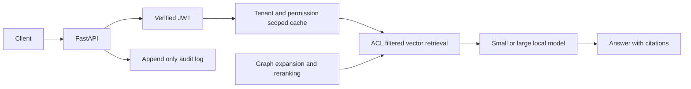

# Northwind RAG Platform



A RAG platform for studying permission enforcement, semantic caching and multi-hop
retrieval with reproducible evaluations. Development follows M0–M5 in TASK.md.
**Current status: M1 baseline RAG and evaluation harness**; the diagram shows the
intended completed system. The public-corpus baseline provides ingestion, `/ask`,
citations and evaluation. Authentication, caching and graph retrieval arrive in M2-M5.
The mock installation and checks pass on Windows with Python 3.11.9. Docker Compose
configuration validates; container startup and the real model adapters are unverified.
Ollama was unavailable in the development environment.

## Windows 11 quickstart (PowerShell)

```powershell
py -3.11 -m venv .venv311
.\.venv311\Scripts\Activate.ps1
$env:RAG_MODE="mock"
python tasks.py install
python tasks.py lint
python tasks.py test
python tasks.py eval
python tasks.py run
```

If PowerShell blocks activation, use `.\.venv311\Scripts\python.exe` instead of
`python`. The `/health` endpoint is available at http://localhost:8000/health.
Use `Copy-Item .env.example .env` for configuration. Do not commit .env.
Mock mode runs without Docker, a model download, an API key or network access
after dependencies have been installed. Dependency installation needs package access.

On POSIX: `python3.11 -m venv .venv`, activate `.venv/bin/activate`, then run
`RAG_MODE=mock python tasks.py test`. A Makefile is available when make is installed.

All targets work through `python tasks.py TARGET` or `make TARGET`:
`install`, `test`, `lint`, `up`, `down`, `ingest`, `run`, `eval`, `bench-cache`,
`bench-acl`, `bench-graph`, `dashboard`, `report`. Later feature targets are wired
now; their modules will be implemented in the milestones listed in PROGRESS.md.
Extra arguments are forwarded, for example `python tasks.py test -q`.

## Baseline RAG and evaluation

The committed Northwind Cloud corpus contains 20 fictional Markdown documents,
including similar EU/US refund policies and Pro/Team plan descriptions. The reviewed
starter evaluation has 45 hand-written questions: 40 answerable and 5 not in the corpus.
These fixtures are fictional product facts, not measurements of a real service.

```powershell
$env:RAG_MODE="mock"
python tasks.py ingest
python tasks.py eval --tag baseline --limit 45
python tasks.py run
```

In a second PowerShell window, send a question:

```powershell
$body = @{question="How long is the EU refund window?"} | ConvertTo-Json
Invoke-RestMethod -Uri http://localhost:8000/ask -Method Post -ContentType "application/json" -Body $body
```

`POST /ask` accepts only a question and returns answer, cited sources, up to five
retrieved chunks with provenance and scores, model, token counts and measured latency.
Blank questions receive HTTP 422. Numbered citations determine `sources`; the complete
retrieved source list is available in `chunks`. This M1 endpoint is for a public corpus.

Chunking targets 400 words with 60 words of overlap, preferring paragraph boundaries.
Re-ingestion replaces a folder's documents, removes stale chunks and bumps a SQLite
corpus version. Sources are paths relative to the document folder, with forward slashes
on every OS. Document IDs incorporate the resolved folder path and chunk IDs are stable
for unchanged chunk positions. Moving the folder changes document IDs.

**Mock indexes are process-local.** A separate `ingest` command demonstrates ingestion
but cannot populate a future process's in-memory Qdrant. Mock service/evaluation processes
reload `RAG_DOCS_DIR` on first use. Real ingestion writes to the configured Qdrant server.
Use the same `RAG_STATE_DB` for ingestion and serving so they share corpus version metadata.
That metadata is currently local SQLite even when the vector server is remote.

For a custom corpus:

```powershell
$env:RAG_DOCS_DIR="C:\My documents\Northwind"
$env:RAG_STATE_DB="C:\My documents\Northwind state.db"
python tasks.py ingest
```

Use a matching evaluation dataset when evaluating a custom corpus:
`python tasks.py eval --dataset "C:\My documents\reviewed eval.jsonl" --tag custom`.

The evaluation writes `eval/results/{tag}_{UTC timestamp}.csv`, with per-question
answers, retrieved/cited sources, expected-source hit, correctness, latency, tokens,
reference-price cost, corpus version and runtime mode. Correctness includes unanswerable
questions; hit rate includes only questions with an expected source. p50/p95 and mean
cost describe the actual run. Judge overhead is recorded separately from answer cost.
Every mock CSV row is labeled `MOCK`, and console output says `MOCK (not a result)`.

Mock judging uses case/punctuation-normalized multiset token F1, excluding citations,
and labels F1 >= 0.5 correct. It can incorrectly accept answers with a wrong number or
entity. The mock LLM quotes context rather than providing a realistic concise answer,
so its correctness scores do not measure answer quality. Real judging requests
`CORRECT` or `INCORRECT` from the configured judge model at temperature zero.

Costs are **estimated at reference prices** from `app/config.py:PRICES`, in USD per
million input/output tokens. The initial small/large tier values are illustrative
assumptions, not verified provider list prices or actual local-model charges. Configure
and document appropriate prices before interpreting a real cost comparison.

## Corpus helpers and human review

Download user-specified public **plain-text or Markdown** URLs listed one per line:

```powershell
python -m scripts.fetch_corpus urls.txt --output-dir data/docs
```

The helper reports each failure and keeps successful downloads when network access
is unavailable. It saves response text as UTF-8 `.txt`; it does not extract main content
from HTML pages. Downloaded data is ignored by Git.

Generate candidate evaluation items without overwriting the reviewed dataset:

```powershell
python -m scripts.gen_eval --docs data/docs_sample --output data/eval_candidates.jsonl
```

Every generated item has `needs_review: true`. Review the question, reference and
source against the actual document, then set `needs_review: false` and promote selected
items into the reviewed dataset. The evaluator rejects items still marked for review.
Mock generation produces deterministic draft templates for software checks only.
The generator refuses to overwrite `data/eval.jsonl` or an existing candidate file.

Sample up to 30 judged rows, fill `human_verdict` with `CORRECT` or `INCORRECT`, then
calculate agreement over completed rows:

```powershell
python -m eval.judge_check "eval/results/baseline_TIMESTAMP.csv" --output eval/results/judge_review.csv
python -m eval.judge_check eval/results/judge_review.csv --agreement
```

Replace `baseline_TIMESTAMP.csv` with a CSV produced by your evaluation. Sampling is
seeded and does not overwrite existing human work. An untouched sample has no agreement
score, rather than claiming that human validation occurred.

## Containers

`docker compose up --build` starts Qdrant, Postgres 16, Neo4j 5 and the API.
The API defaults to mock mode. Set `RAG_MODE=real` in .env to opt into real adapters.
Database credentials in compose are public development defaults; replace them
before deploying. Container Ollama calls use `host.docker.internal:11434`.

## Producing real results

No real benchmark has run yet. Baseline ingestion/evaluation are implemented; benchmark,
dashboard and report commands below require the later milestones.
Real model adapters require sentence-transformers and LiteLLM (optional dependency
setup and installed-API verification remain pending, as recorded in PROGRESS.md).

```powershell
ollama pull llama3.2:3b
ollama pull qwen2.5:7b
Copy-Item .env.example .env
$env:RAG_MODE="real"
$env:SMALL_MODEL="ollama/llama3.2:3b"
$env:LARGE_MODEL="ollama/qwen2.5:7b"
docker compose up -d qdrant postgres neo4j
python tasks.py ingest
python tasks.py eval
python tasks.py bench-acl
python tasks.py test tests/test_leakage.py
python tasks.py bench-cache
python tasks.py bench-graph
python tasks.py report
```

Review the evaluation dataset, human judge verdicts, merge groups and failure
analysis before publishing results. Cost estimates will use explicitly labeled
reference prices, since local models do not incur paid API charges.

<!-- RESULTS:START -->
| Project | Real measurements |
| --- | --- |
| Baseline RAG | NOT YET RUN |
| Permission-aware retrieval | NOT YET RUN |
| Semantic caching and routing | NOT YET RUN |
| GraphRAG | NOT YET RUN |
<!-- RESULTS:END -->

Dashboard screenshot: pending implementation and a real run.

## Limitations

Mock embeddings and answers test software contracts, not retrieval quality.
Ingestion prepares documents before writing, but SQLite and Qdrant are not a single
transaction: a Qdrant write failure can leave a partially replaced corpus. Re-ingest
after a failure, and avoid querying while ingestion runs. Authentication is not yet
implemented; do not load private documents into this baseline.
The finished evaluation must account for a small corpus, LLM judge bias, estimated
reference costs, semantic cache false hits, extraction and resolution errors,
GraphRAG indexing cost, and demo-grade authentication. See DECISIONS.md for trade-offs.
