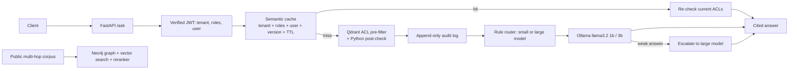

# Northwind RAG Platform

A RAG service with three engineering upgrades, each measured against a baseline with
repeatable scripts: **permission-aware multi-tenant retrieval**, **semantic caching with
cost-aware routing**, and **GraphRAG for multi-hop questions**. Everything runs locally
on free, open-source components (Ollama, Qdrant, Postgres, Neo4j, sentence-transformers).

All results below come from real-mode runs on one Windows laptop (CPU only) using small
local models. Sample sizes are small; see [Limitations](#limitations).



## Results

Setup: embeddings `all-MiniLM-L6-v2`; reranker `ms-marco-MiniLM-L-6-v2`; answers,
judging and extraction with `llama3.2:3b`; small model `llama3.2:1b`. Costs are
**estimated at published reference prices** (local models are free), not real charges.
Raw files are in [`results_archive/`](results_archive/).

### Baseline RAG (45 questions: 40 answerable, 5 not in the corpus)

| Measure | Result | Source |
| --- | --- | --- |
| Correct answers, by my manual review | **41 / 45** | `hand_labels.csv` |
| Right document retrieved (answerable questions) | 40 / 40 | `baseline_20261016T113102722229Z.csv` |
| Automatic `reference_in_answer` check agrees with my labels | 86.7% | `hand_labels.csv` |
| 3B LLM judge agrees with my labels | 73.3% | `hand_labels.csv` |

The LLM judge produced false negatives, so quality in the benchmarks below uses the
deterministic `reference_in_answer` check. The corpus has only 20 documents, so the
retrieval hit rate is inflated by design.

### Project 2: permission-aware multi-tenant RAG

| Measure | Result | Source |
| --- | --- | --- |
| Adversarial leakage suite against a **live Qdrant server** (v1.17.0) | **602 passed, 0 leaks** (600 user × question cases + 2 negative controls) | `leakage_live_qdrant.txt` |
| Median filtering overhead, 200 paired queries | about 0 ms (−0.012 ms; within noise) | `acl_20261016T115829984069Z.csv` |
| Time for a permission revoke to take effect | 66.6 ms | `acl_20261016T115829984069Z.csv` |

Design: identity comes only from the verified JWT; the ACL is applied *inside* the vector
query, then re-checked in Python; every retrieval is written to an append-only audit log.
The negative controls disable the filter and confirm the test suite detects leaks.
The live-server run used deterministic hash embeddings and a SQLite audit log, not real
embeddings or Postgres.

### Project 1: semantic cache and cost-aware routing (75 requests per system, 40% repeats)

| Measure | Always-large (baseline) | Cache + routing | Source |
| --- | --- | --- | --- |
| Estimated cost (reference prices) | $0.178 | $0.075 (**−58.0%**) | `summary_project1_real_threshold090.json` |
| Quality (`reference_in_answer`) | 89.3% | 92.0% | same |
| p50 latency | 11.2 s | 15.4 s (**slower**) | same |
| p95 latency | 15.4 s | 37.8 s (**slower**) | same |
| Cache hit rate | 0% | 13.3% | same |
| Small-model escalation rate | n/a | 43.1% (28 of 65 simple-routed) | same |

- Cost fell mainly because most requests were answered by the small model. Latency rose
  because the 1B model answered "I don't know" on 43% of its requests and every one of
  those costs a second call. The +2.7-point quality difference is two answers, so read
  it as "no measurable loss".
- This comparison ran with `CACHE_THRESHOLD=0.90` and the number/entity guard on. In the
  100-pair tuning sweep (`cache_sweep_20261017T073343622572Z.csv`), 0.90 had **2 false hits
  out of 50 near-miss pairs**; the lowest threshold with zero false hits was **0.96**, where only
  6% of true paraphrases hit. All 10 cache hits in this run returned the correct answer.
- Rule-based routing (81% accuracy on 100 labeled queries) beat an LLM classifier (74%).
- Turning on "escalate when there is no citation" raised escalation to 90% and tripled
  p50 latency, so it is off by default.

### Project 3: GraphRAG (60 HotpotQA distractor questions, seed 42)

| System | Exact match | F1 | Supporting-fact recall | Latency / query | Input tokens / query |
| --- | --- | --- | --- | --- | --- |
| Vector only | 0.300 | 0.421 | 0.850 | 17.7 s | 997 |
| Graph hybrid | **0.450** | **0.560** | **0.908** | 25.5 s | 1,479 |

Source: `summary_project3_real_final.json`. The graph system answered 9 more questions
exactly (27 vs 18 of 60) at about 48% more tokens and 8 s more latency per query.
Graph: 2,898 raw entities merged to 2,859 canonical entities (39 merges, listed in
`merge_groups.txt`); 38 of 2,924 extracted relations were dropped for undeclared
endpoints. Decomposition was not evaluated with the 3B model because it returned invalid
sub-question lists.

## Quickstart (Windows PowerShell)

```powershell
python -m venv .venv
.\.venv\Scripts\Activate.ps1
python -m pip install -r requirements-real.txt
Copy-Item .env.example .env          # then set JWT_SECRET and the model names
docker compose up -d qdrant postgres # add neo4j for Project 3
ollama pull llama3.2:1b
ollama pull llama3.2:3b
$env:RAG_MODE = "real"
python tasks.py ingest
python tasks.py eval
python tasks.py bench-acl
python tasks.py bench-cache
python tasks.py bench-graph --dataset hotpotqa --n 60 --seed 42 --no-fallback --systems vector,graph_hybrid
```

Postgres is mapped to host port **5433** because a local Windows Postgres often occupies
5432. Mock mode (`RAG_MODE=mock`) runs the whole test suite with no models or network:
`python tasks.py test`. Full command list, API examples and design notes are in
[docs/IMPLEMENTATION_NOTES.md](docs/IMPLEMENTATION_NOTES.md).

## Limitations

- **Small samples.** 45 baseline questions, 75 requests per Project 1 system, 60 graph
  questions, one run each. A single question moves graph exact match by 1.7 points; I have
  not computed confidence intervals.
- **Tiny corpus.** 20 documents, so retrieval hit rates look better than they would at
  scale.
- **Costs are estimates** at commercial reference prices; local compute is not counted.
- **Project 1 latency got worse**, not better, because of escalation from a weak 1B model
  and possible model swapping between the 1B and 3B models on one machine.
- **Cache threshold.** The measured run used 0.90 (2/50 near-miss false hits in tuning); a
  safe 0.96 leaves very little cache benefit with this embedding model. Similarity does not
  prove two questions have the same answer.
- **The 3B LLM judge is unreliable** (73% agreement with my labels), so I do not report its
  scores as quality.
- **Project 2 evidence is narrower than "production secure".** The live suite used a fixed
  seed corpus with mock embeddings and SQLite auditing; Postgres audit triggers, the Docker
  `api` container, multi-worker deployment and login rate limiting were not tested.
  Demo authentication only.
- **Project 3.** HotpotQA has no single-hop questions, so I could not test whether the graph
  helps or hurts easy questions. Indexing cost is partly measured (400 of 600 paragraphs have
  first-fill measurements: 77,518 input and 170,046 output tokens, about $1.89 at reference
  prices); its recorded time includes stalls and timeouts from earlier runs. Unknown relation
  types were mapped to `RELATED_TO`, and the extraction cache mixes code versions.
- **Environment.** Real runs used Python 3.14 on Windows; the Qdrant Python client (1.19.1)
  is newer than the server (1.17.0), which prints a compatibility warning.


