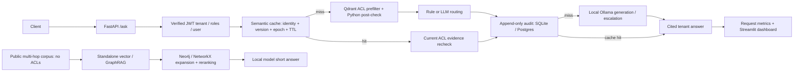

# Northwind RAG Platform



A reproducible RAG lab for three practical problems: reducing repeated model work with
semantic caching and cost-aware routing; enforcing tenant permissions before evidence
reaches generation; and answering multi-hop questions through evidence-backed graph
expansion. It includes a JWT-authenticated API, local-model adapters, append-only audits,
a measurement dashboard, paired benchmarks and a report generator that keeps mock checks
separate from real measurements. The public baseline and GraphRAG corpus are separate
from protected tenant documents.

**M0–M5 implemented; offline acceptance verified on Windows/Python 3.11.** Real model
quality/performance benchmarks and live Postgres/Neo4j behavior remain unverified.
Five-question real baseline smokes and live-Qdrant ACL fixture checks have run; their
limited scope is documented below. No mock scores are presented
as production results. See [PROGRESS.md](PROGRESS.md) for the milestone verification log
and [interview study notes](docs/STUDY_NOTES.md) for the three projects' trade-offs.

## Recorded results

<!-- RESULTS:START -->
Generated by `python tasks.py report`. Real measurements and mock checks are separate.
Reference costs are USD estimates, not local-model charges.

| Project | Latest real run | Latest mock check |
| --- | --- | --- |
| Baseline RAG | NOT YET RUN | MOCK (not a result) — `baseline_20261013T123347119648Z.csv` |
| Project 1: cache and routing | NOT YET RUN | MOCK (not a result) — `project1_optimized_20261013T123357732368Z.csv` |
| Project 2: permission-aware retrieval | NOT YET RUN | MOCK (not a result) — `acl_20261013T123350396285Z.csv` |
| Project 3: GraphRAG | NOT YET RUN | MOCK (not a result) — `project3_20261013T123348499080Z.csv` |

### Baseline RAG

| Questions | Correctness | Source hit rate | p50 / p95 latency (ms) | Mean reference answer cost (USD) |
| --- | --- | --- | --- | --- |
| NOT YET RUN | NOT YET RUN | NOT YET RUN | NOT YET RUN | NOT YET RUN |

### Project 1: semantic cache and routing

| Requests / system | Actual repeat ratio | Reference cost reduction (%) | Quality delta | Cache hit rate | Escalation rate | p50 / p95 change (ms) |
| --- | --- | --- | --- | --- | --- | --- |
| NOT YET RUN | NOT YET RUN | NOT YET RUN | NOT YET RUN | NOT YET RUN | NOT YET RUN | NOT YET RUN |

### Project 2: permission-aware multi-tenant retrieval

| Paired raw vector queries | Median paired filter overhead (ms) | Revoke-to-effect (ms) |
| --- | --- | --- |
| NOT YET RUN | NOT YET RUN | NOT YET RUN |

Raw vector timing excludes generation/audit. Offline leakage tests are security regressions, not a real-model leakage-rate estimate.

### Project 3: GraphRAG

| System / subset | Questions | EM | F1 | Supporting-title recall | Mean latency (ms) | Mean input / output tokens | Mean reference cost (USD) |
| --- | --- | --- | --- | --- | --- | --- | --- |
| vector / all | NOT YET RUN | NOT YET RUN | NOT YET RUN | NOT YET RUN | NOT YET RUN | NOT YET RUN | NOT YET RUN |
| vector / multihop | NOT YET RUN | NOT YET RUN | NOT YET RUN | NOT YET RUN | NOT YET RUN | NOT YET RUN | NOT YET RUN |
| vector / singlehop | NOT YET RUN | NOT YET RUN | NOT YET RUN | NOT YET RUN | NOT YET RUN | NOT YET RUN | NOT YET RUN |
| graph_hybrid / all | NOT YET RUN | NOT YET RUN | NOT YET RUN | NOT YET RUN | NOT YET RUN | NOT YET RUN | NOT YET RUN |
| graph_hybrid / multihop | NOT YET RUN | NOT YET RUN | NOT YET RUN | NOT YET RUN | NOT YET RUN | NOT YET RUN | NOT YET RUN |
| graph_hybrid / singlehop | NOT YET RUN | NOT YET RUN | NOT YET RUN | NOT YET RUN | NOT YET RUN | NOT YET RUN | NOT YET RUN |
| decomposition / all | NOT YET RUN | NOT YET RUN | NOT YET RUN | NOT YET RUN | NOT YET RUN | NOT YET RUN | NOT YET RUN |
| decomposition / multihop | NOT YET RUN | NOT YET RUN | NOT YET RUN | NOT YET RUN | NOT YET RUN | NOT YET RUN | NOT YET RUN |
| decomposition / singlehop | NOT YET RUN | NOT YET RUN | NOT YET RUN | NOT YET RUN | NOT YET RUN | NOT YET RUN | NOT YET RUN |

One-time real indexing usage/time: NOT YET RUN.
<!-- RESULTS:END -->

## One-command container quickstart

With Docker Desktop running, the default mock demo starts with:

```powershell
docker compose up --build
```

This starts the API at http://localhost:8000/docs and the three service containers.
The mock API loads demo data automatically. Container startup was not verified here;
Compose configuration was validated. For a host Python process using only containerized
databases, after the Python setup below:

```powershell
docker compose up -d qdrant postgres neo4j
python tasks.py ingest
python tasks.py run
```

If make is installed, the last two commands are `make ingest` and `make run`. Start the
service containers only in this workflow so the host API can own port 8000. Real mode
also needs the local models and configuration described under Producing real results.

## Windows 11 quickstart (PowerShell)

```powershell
py -3.11 -m venv .venv311
.\.venv311\Scripts\Activate.ps1
$env:RAG_MODE="mock"
python tasks.py install
python tasks.py lint
python tasks.py test
python tasks.py eval
python tasks.py run
```

If PowerShell blocks activation, use `.\.venv311\Scripts\python.exe` instead of
`python`. The `/health` endpoint is available at http://localhost:8000/health.
Use `Copy-Item .env.example .env` for configuration. Do not commit .env.
Mock mode runs without Docker, a model download, an API key or network access
after dependencies have been installed. Dependency installation needs package access.

For real mode, install the separate pinned dependency set in the same Python 3.11
environment before selecting the mode:

```powershell
python -m pip install -r requirements-real.txt
python -m pip check
$env:RAG_MODE="real"
```

`requirements-real.txt` includes `requirements.txt` plus sentence-transformers and
LiteLLM. `python tasks.py install` installs the offline/mock stack only. Real-mode
installation also downloads PyTorch and other model libraries; model weights, Ollama
and database services still need the setup under Producing real results. On POSIX, use
the same pip command and `export RAG_MODE=real`. Without activation on Windows, replace
`python` with `.\.venv311\Scripts\python.exe` in these commands.
The default Docker image installs only the mock stack; use this host setup for real
mode, or install requirements-real.txt in a custom real-mode image.
If NEO4J_URI is configured (including through .env), the full test command opts into
live Neo4j integration. Without a running service, use
`python tasks.py test -m "not integration" -q` for the offline suite.

On POSIX: `python3.11 -m venv .venv`, activate `.venv/bin/activate`, then run
`RAG_MODE=mock python tasks.py test`. A Makefile is available when make is installed.

All targets work through `python tasks.py TARGET` or `make TARGET`:
`install`, `test`, `lint`, `up`, `down`, `ingest`, `run`, `eval`, `bench-cache`,
`bench-acl`, `bench-graph`, `dashboard`, `report`. All targets are implemented;
consult PROGRESS.md for validation scope.
Extra arguments are forwarded, for example `python tasks.py test -q`.

## Baseline RAG and evaluation

The committed Northwind Cloud corpus contains 20 fictional Markdown documents,
including similar EU/US refund policies and Pro/Team plan descriptions. The reviewed
starter evaluation has 45 hand-written questions: 40 answerable and 5 not in the corpus.
These fixtures are fictional product facts, not measurements of a real service.

```powershell
$env:RAG_MODE="mock"
python tasks.py ingest
python tasks.py eval --tag baseline --limit 45
python tasks.py run
```

The baseline evaluator uses the isolated `baseline_chunks` collection. The authenticated
HTTP API uses the ACL-protected `chunks` collection and the fictional tenant corpus.
In a second PowerShell window, log in and send a tenant question:

```powershell
$credentials = @{username="acme.engineer"; password="demo-password"} | ConvertTo-Json
$login = Invoke-RestMethod -Uri http://localhost:8000/auth/login -Method Post -ContentType "application/json" -Body $credentials
$headers = @{Authorization="Bearer $($login.access_token)"}
$body = @{question="What deployment cluster does Acme engineering use?"} | ConvertTo-Json
Invoke-RestMethod -Uri http://localhost:8000/ask -Method Post -Headers $headers -ContentType "application/json" -Body $body
```

`POST /ask` accepts only a question and returns answer, cited sources, up to five
retrieved chunks with provenance and scores, model, token counts and measured latency.
With valid authentication, blank questions receive HTTP 422. Missing, expired or tampered
tokens receive HTTP 401. Numbered citations determine `sources`; the complete retrieved
source list is available in `chunks`. Identity comes exclusively from signed JWT claims;
body fields such as `tenant_id`, `roles` or `user_id` are ignored.

Chunking targets 400 words with 60 words of overlap, preferring paragraph boundaries.
Re-ingestion replaces a folder's documents, removes stale chunks and bumps a SQLite
corpus version. Sources are paths relative to the document folder, with forward slashes
on every OS. Document IDs incorporate the resolved folder path and chunk IDs are stable
for unchanged chunk positions. Moving the folder changes document IDs.

**Mock indexes are process-local.** A separate `ingest` command demonstrates ingestion
but cannot populate a future process's in-memory Qdrant. Mock service/evaluation processes
reload their configured corpus on first use: `RAG_DOCS_DIR` for baseline evaluation,
`RAG_SEED_DIR/documents.json` for the authenticated API. Real ingestion writes to Qdrant.
Use the same `RAG_STATE_DB` for ingestion and serving so they share corpus version metadata.
That metadata is currently local SQLite even when the vector server is remote.

For a custom corpus:

```powershell
$env:RAG_DOCS_DIR="C:\My documents\Northwind"
$env:RAG_STATE_DB="C:\My documents\Northwind state.db"
python tasks.py ingest --corpus baseline
```

Use a matching evaluation dataset when evaluating a custom corpus:
`python tasks.py eval --dataset "C:\My documents\reviewed eval.jsonl" --tag custom`.

The evaluation writes `eval/results/{tag}_{UTC timestamp}.csv`, with per-question
answers, retrieved/cited sources, expected-source hit, correctness, latency, tokens,
reference-price cost, corpus version and runtime mode. Correctness includes unanswerable
questions; hit rate includes only questions with an expected source. p50/p95 and mean
cost describe the actual run. Judge overhead is recorded separately from answer cost.
Every mock CSV row is labeled `MOCK`, and console output says `MOCK (not a result)`.
The `judge_raw` column preserves the judge completion's exact text. The parser searches
case-insensitively for the verdict word `INCORRECT` first, then `CORRECT`; otherwise it
records `judge_label=unparseable` and an empty `correct` cell. It never silently counts
an unparseable reply as incorrect. The judge prompt allows extra words/citations when
the key fact matches, with one correct and one incorrect few-shot example. Mock token-F1
judging makes no model call, so its `judge_raw` cell is empty.

The adjacent `reference_in_answer` column is a separate deterministic check: lowercase,
remove numbered citations/punctuation, collapse whitespace, and look for the nonempty
reference as a contiguous phrase at token boundaries. This avoids matching 4 days inside
14 days, but it can accept negated answers containing the reference and miss paraphrases.
It does not replace semantic judging.

The baseline summary reports `judge_accuracy` (fraction rated correct among parseable
verdicts, not the judge's agreement with human labels), `reference_in_answer_accuracy`
over all questions, and `disagreement_count`/`disagreement_rate` over parseable pairs.
`judge_parsed_count`, `judge_unparseable_count` and `disagreement_compared_count` make
the denominators explicit. An all-unparseable run has null judge accuracy/disagreement
rate; legacy `correctness` aliases judge accuracy. The baseline warms retrieval/generation
and the judge before measured questions; warm-up responses are excluded from rows,
latency and per-question token/cost metrics, with warm-up usage/cost reported separately.
This reduces first-use loading effects; server eviction or concurrent traffic can still
cause later model reloads. Older CSVs with cold first requests are not directly comparable.

Mock judging uses case/punctuation-normalized multiset token F1, excluding citations,
and labels F1 >= 0.5 correct. It can incorrectly accept answers with a wrong number or
entity. The mock LLM quotes context rather than providing a realistic concise answer,
so its correctness scores do not measure answer quality. Real judging requests
`CORRECT` or `INCORRECT` from the configured judge model at temperature zero.

Costs are **estimated at reference prices** from `app/config.py:PRICES`, in USD per
million input/output tokens. M3 verified the reference tiers against the published
[GPT-4o Mini](https://developers.openai.com/api/docs/models/gpt-4o-mini) and
[GPT-4o](https://developers.openai.com/api/docs/models/gpt-4o) text-token prices on
2026-10-12. Those tiers are comparison proxies for the configured small/large models,
not charges for local Ollama calls. `REFERENCE_SMALL_INPUT`, `REFERENCE_SMALL_OUTPUT`,
`REFERENCE_LARGE_INPUT` and `REFERENCE_LARGE_OUTPUT` can override rates for another
comparison. A small call followed by a large escalation is charged at each call's own
reference tier; optional router-classifier tokens are included too.

## Permission-aware RAG (Project 2)

`data/seed/` contains three fictional tenants (Acme, Globex, Initech), five users per
tenant and six documents per tenant. The documents cover public FAQs, employee
onboarding, engineering wikis, confidential HR salaries, board notes and user-only
contractor instructions. Distinct marker strings make leaks detectable offline.
All users have the intentionally public **demo-only** password `demo-password`;
committed user records contain salted PBKDF2-SHA256 hashes, not plaintext passwords.

Demo usernames are `acme.employee`, `acme.engineer`, `acme.hr`, `acme.admin` and
`acme.contractor`; replace `acme` with `globex` or `initech` for the other tenants.
Contractors have no role grants and exercise explicit-user access. Administrators have
no implicit bypass: an explicit-user-only document is not readable by an admin unless
its metadata also grants that admin access.

Every ACL chunk requires `tenant_id`, `allowed_roles` and `classification`, with optional
`allowed_users`. The vector query requires tenant equality **and** at least one matching
role or user grant, using Qdrant's `min_should` with `min_count=1`. Even a `public` document
requires the same tenant and an explicit grant. Classification is a validated label
(`public`, `internal`, `confidential`), not an additional inferred clearance system.
The post-check drops malformed or forbidden evidence, emits a critical log entry, and
increments the tenant's counter before any context is sent to the LLM.

Run the security checks and benchmark from PowerShell:

```powershell
$env:RAG_MODE="mock"
python tasks.py test tests/test_leakage.py
python tasks.py bench-acl --queries 200
python tasks.py ingest --corpus seed
```

The leakage suite parametrizes every seeded user over 40 adversarial questions
(600 combinations). Its oracle derives forbidden documents and markers from the seed
data, independently of the production filter. It checks raw vector results, returned
chunk IDs/text and generated answers, and requires accessible documents to be returned.
Negative controls disable the filter and then both defenses, proving the oracle detects
leaks. HTTP tests use genuinely signed local JWTs and cover body spoofing, missing,
expired, tampered and unsupported-algorithm tokens. These are mock security regression
tests, not real-model quality or production-scale performance measurements.

**Backend clarification:** `tests/test_leakage.py` always uses in-memory Qdrant, even
when pytest is launched with `RAG_MODE=real`. `tests/conftest.py` sets the per-test mode
to mock, and `RecordingClient()` explicitly defaults to `QdrantClient(":memory:")`.
The module fixture now also sets mock mode during ingestion, before the function fixture
runs. `RAG_MODE=real` alone never turns that file into a live-server test.

The separate `tests/test_leakage_qdrant_integration.py` reuses the exact same 600
user/question assertion cases against `http://localhost:6333`, plus both negative
controls. It uses a uniquely named disposable `leakage_integration_<uuid>` collection,
server-side ACL payload indexes and filtering, and deletes only that owned collection.
It does not write to the application's `chunks`, `baseline_chunks` or cache collections.
The URL is explicit, independent of RAG_MODE/QDRANT_URL; no in-memory fallback exists.

```powershell
$env:RUN_QDRANT_INTEGRATION="1"
python tasks.py test tests/test_leakage_qdrant_integration.py -m integration -q
Remove-Item Env:RUN_QDRANT_INTEGRATION
```

Start Qdrant first if necessary: `docker compose up -d qdrant`. On POSIX, use
`RUN_QDRANT_INTEGRATION=1 python tasks.py test tests/test_leakage_qdrant_integration.py -m integration -q`.
The suite skips without that opt-in; when enabled, connection/service failures fail
visibly. Embeddings and completions remain deterministic mocks and audit uses temporary
SQLite, deliberately isolating live Qdrant permission behavior from LLM/GPU/Postgres setup.
Disabling the prefilter must expose a forbidden raw result that the independent oracle
detects, while the post-check still protects the response. Disabling both defenses must
also make the response oracle detect leaks. These are expected negative controls.

| Security check / recorded output | Qdrant backend | Other adapters | Evidence scope |
| --- | --- | --- | --- |
| Original leakage suite (`test_leakage.py`) | In-memory Qdrant client, no server | Mock hash embeddings/completions; SQLite audit | 600 adversarial combinations plus controls and signed-JWT HTTP checks |
| Cached leakage suite (`test_cache_leakage.py`) | In-memory Qdrant client, no server | Mock models; SQLite audit/state | 600 cached-service combinations; no live-cache claim |
| New live leakage integration | HTTP localhost:6333; server 1.17.0, client 1.19.1 | Mock hash embeddings/completions; SQLite audit | 602 tests passed on 2026-10-16: 600 cases and two negative controls; collection cleanup verified |
| Recorded MOCK ACL benchmark CSVs | In-memory Qdrant (`qdrant_memory` in CSV) | No LLM generation in raw timing | Software timing only; not server performance |

The live run emitted the client/server minor-version compatibility warning; it was not
suppressed. This verifies the small seed fixture's live filter/index behavior despite
that warning, not general version compatibility or production-scale performance.
Five-question REAL baseline smokes use the public baseline pipeline and real models;
they are separate from tenant ACL/cache leakage verification. The generated results
tables describe benchmarks, not a production leakage-rate estimate.

The ACL benchmark creates a disposable collection, alternates filtered/unfiltered query
order over at least 200 pairs, writes per-pair timings and prints median paired overhead.
It tests that a previously accessible document is absent from the very next query after
revocation. Filtering timings measure raw vector operations only; they exclude embedding,
model generation and production audit overhead. Revoke-to-effect timing includes epoch
increment, payload update and one verification query. All mock rows are labeled `MOCK`.
The unfiltered path exists only inside this isolated benchmark, never as an API option.

### Administrator endpoints and audit

The verified `admin` role is required for:

- `GET /admin/metrics`: process-local post-check drops for the caller's tenant.
- `GET /admin/doc-access/{doc_id}?days=30`: exact document access records, tenant-scoped;
  `days` must be between 1 and 365.
- `PATCH /admin/docs/{doc_id}/acl`: replace all role/user grants and classification
  on every chunk of a document in the caller's tenant. Cross-tenant IDs return 404.

For example, after logging in as `acme.admin`, revoke engineering access:

```powershell
$credentials = @{username="acme.admin"; password="demo-password"} | ConvertTo-Json
$login = Invoke-RestMethod -Uri http://localhost:8000/auth/login -Method Post -ContentType "application/json" -Body $credentials
$headers = @{Authorization="Bearer $($login.access_token)"}
$acl = @{allowed_roles=@("admin"); allowed_users=@(); classification="confidential"} | ConvertTo-Json
Invoke-RestMethod -Uri http://localhost:8000/admin/docs/acme:engineering-wiki/acl -Method Patch -Headers $headers -ContentType "application/json" -Body $acl
Invoke-RestMethod -Uri "http://localhost:8000/admin/doc-access/acme:engineering-wiki?days=30" -Headers $headers
```

Updates wait for Qdrant completion and advance the persisted `cache_epoch` before
mutation, invalidating cached answers. A process-local lock serializes retrieval
snapshots and admin updates in the single-worker API. Already-running generation can
finish using its earlier snapshot. Mock ACL edits reset to committed fixtures on process
restart; SQLite audit history and the epoch persist.

Every authenticated retrieval is committed to `audit_log` before generation, including
empty results and failed vector queries. Audit failure blocks generation. Records contain
request ID, UTC time, verified user/tenant, query, delivered chunk/document IDs and model.
An exact-match evidence index avoids substring matches in document access queries.
The offline public baseline evaluator and raw isolated benchmark are separate from this
authenticated request path.

Mock audit uses SQLite at `RAG_AUDIT_DB` even when DATABASE_URL names Postgres. SQLite
triggers reject UPDATE/DELETE and replacement of existing identities on both audit tables;
the store exposes append/read only.
Real mode uses SQLAlchemy/psycopg with PostgreSQL. After table creation, startup applies
`migrations/001_append_only_audit.sql`, whose statement triggers reject UPDATE, DELETE
and TRUNCATE. The migration syntax was checked against
[PostgreSQL 16's trigger documentation](https://www.postgresql.org/docs/16/sql-createtrigger.html),
but has not been executed against a live server here. A database owner can disable or
drop triggers; production needs a separate migration owner and restricted application
role. SQLite file owners can also alter the database outside the application.

Mock JWT signing uses a randomly generated process-local key when `JWT_SECRET` is empty.
Real mode requires an explicitly configured key of at least 32 bytes. Generate one for
a local real-mode process without committing it:

```powershell
$env:JWT_SECRET = python -c "import secrets; print(secrets.token_urlsafe(48))"
```

For Docker or multiple workers, put the same random key in the ignored `.env`. Default
token lifetime is one hour (`JWT_TTL_SECONDS`). Demo authentication has no account
provisioning, refresh/revocation service or login rate limiting; role changes require
a new token, while document ACL revocation affects the next query immediately.

## Semantic cache and model routing (Project 1)

The `/ask` service embeds a normalized question, checks a separate vector cache, then
on a miss retrieves permitted evidence, routes to the small or large model, and escalates
a small-model answer when evidence is weak or it says `I don't know`. Missing valid
citations additionally trigger escalation when `ESCALATE_NO_CITATION=true` (default off).
Each returned response retains the original RAG interface. Detailed
route, cache, escalation, usage and reference-cost measurements go into `requests`.

A cache hit requires all of the following:

- Similarity at least `CACHE_THRESHOLD` (default 0.96; existing environment overrides still apply).
- Matching corpus version and current ACL epoch.
- Nonnegative age below `CACHE_TTL_SECONDS` (initially 600 seconds).
- Same verified tenant, sorted-role fingerprint **and user ID**.
- Matching number/entity sets when `CACHE_GUARD=true`.

The user-ID key is necessary because two users with the same roles can have different
explicit-user grants. Cache queries apply scope/version/epoch/age predicates inside
Qdrant, followed by application checks. Up to ten matching neighbors are considered
so a guard rejection does not force a miss when another eligible entry exists.
Before serving a hit, the service queries the stored evidence IDs with the current ACL
pre-filter, rechecks metadata and verifies unchanged text/provenance. It then writes an
audit entry with `cache_hit=true` and the evidence document IDs. Cache hits incur zero
new LLM tokens; lookup, evidence checking and audit work still take time.

Empty, uncited, abstaining or failed responses are not cached. A corpus/ACL change during
generation prevents storing that older snapshot. `SemanticCache.clear()` clears its own
collection. The number/entity guard is conservative: it can reject valid aliases or
capitalization variants and does not identify all operation-direction or negation flips.
Semantic similarity is not proof of equivalent questions.

The rule router uses question length, complexity words, rough entity count, retrieval
top score and score spread. `ROUTER_MODE=llm` enables a small-model one-word classifier;
invalid labels fall back to the large-model route. That classifier sees only the verified
caller's question and runs before retrieval. For rule routing, a pure callback selects
the model after the ACL post-check and before the retrieval audit commits, so the audit
records the actual model choice. Both paths audit evidence before answer generation.

Run the complete Project 1 experiments:

```powershell
$env:RAG_MODE="mock"
python tasks.py bench-cache
python tasks.py dashboard
```

Or run an individual experiment:

```powershell
python -m eval.bench_cache_router --sweep
python -m eval.bench_cache_router --router
python -m eval.bench_cache_router --compare --repeat-ratio 0.40
```

The sweep evaluates thresholds 0.85 through 0.99 against 50 curated paraphrase pairs
and 50 near-miss pairs, with and without the guard. It reports the lowest threshold with
zero false hits on this tuning set, or reports none. These are pairwise comparisons,
not a held-out evaluation of every competing cache entry. Do not select a real deployment
threshold from mock embedding scores. Regenerate the fixtures with
`python -m scripts.make_paraphrases`.

Each threshold prints and records `true_paraphrase_hit_rate` and `false_hits`.
The full real all-MiniLM-L6-v2 guarded sweep on 2026-10-16 selected 0.96:
0/50 false hits and 3/50 (6%) true-paraphrase hits, versus 1/50 false hits
at 0.95. This conservative tuning choice sacrifices recall and does not guarantee
zero production false hits. See DECISIONS.md for the measured artifact and rationale.
If an existing `.env` specifies 0.90, explicitly override it in PowerShell:

```powershell
$env:CACHE_THRESHOLD="0.96"
$env:ESCALATE_NO_CITATION="false"
```

The router experiment evaluates both classifiers on 100 hand-labeled intent questions,
including simple questions containing complexity words and multi-step questions without
them. It separately measures answer quality/reference cost for always-large, rule and
LLM routing on the reviewed baseline evaluation. Classifier accuracy and answer quality
are separate measurements; labeling a question correctly does not guarantee a correct
answer.

The comparison copies the public sample corpus into a disposable ACL-protected benchmark
collection. It replays the same seeded mixed workload through always-large/no-cache and
the new service after clearing its cache. The default workload is 40% repeats; half of
repeat events use a template paraphrase. Repeats follow an earlier occurrence of their
source question. Both requested and actual repeat ratios are written to outputs because
small `--limit` runs require rounding. Indexing happens before the measured replay.
The benchmark writes baseline/optimized request CSVs and `summary_project1.json` with
cost reduction, p50/p95 changes, deterministic quality delta, cache hit and escalation rates.
Quality is `reference_in_answer`: the normalized reference occurs in the normalized answer.
It is also recorded as `correct` for report compatibility. The LLM judge remains secondary
in `judge_correct`, `judge_label`, `judge_raw`, and summary `judge_accuracy`.
This lexical metric can miss equivalent wording or accept a fact inside a negated answer.

Every compare invocation runs citation escalation both OFF (the default) and ON on the
same workload, clearing the cache before each optimized replay. `citation_policies` in
the summary contains both results and their CSV filenames; the ON CSV is named
`citation_policy_on_*.csv`, keeping the normal paired report on the default OFF policy.
`escalation_rate` is escalated requests divided by **simple-routed requests**, or null
when there are none. Route shares include simple, complex and cache over all requests;
an escalated request keeps its original simple route. First-answer reasons are
`weak_retrieval`, `missing_citation` and `i_dont_know`, with counts and shares of simple
requests. Reasons can overlap. Weak retrieval and abstention always escalate;
`ESCALATE_NO_CITATION=true` additionally escalates answers without a valid evidence citation.
Uncited answers still cannot enter the semantic cache.
Rows account for both escalation calls and optional classifier usage; judge cost is
separate. Benchmark latency wraps the whole service, including request logging, and
excludes the subsequent reference judge.

The dashboard at http://localhost:8501 shows reference cost/request, cache hit rate,
route split, escalation rate, latency percentiles and measured quality by route over time.
Filter by runtime mode and `run_tag`; API calls use `RUN_TAG` and benchmarks create
distinct tags. `RAG_REQUESTS_DB` selects the SQLite log in mock mode; real mode uses
PostgreSQL. Ordinary API quality is unknown (`NULL`) until an evaluator attaches a score;
the dashboard displays that absence rather than assigning a quality score. Its logged
latency ends just before the final request-log commit; benchmark CSVs also capture that
commit's wall time. The dashboard is a local operator tool without tenant login.

All mock CSV/JSON outputs and the dashboard prominently say `MOCK (not a result)`.
Mock answers still quote context, so their F1 correctness is not model quality. No mock
savings, latency or accuracy measurements populate the real-results table below.

## Corpus helpers and human review

Download user-specified public **plain-text or Markdown** URLs listed one per line:

```powershell
python -m scripts.fetch_corpus urls.txt --output-dir data/docs
```

The helper reports each failure and keeps successful downloads when network access
is unavailable. It saves response text as UTF-8 `.txt`; it does not extract main content
from HTML pages. Downloaded data is ignored by Git.

Generate candidate evaluation items without overwriting the reviewed dataset:

```powershell
python -m scripts.gen_eval --docs data/docs_sample --output data/eval_candidates.jsonl
```

Every generated item has `needs_review: true`. Review the question, reference and
source against the actual document, then set `needs_review: false` and promote selected
items into the reviewed dataset. The evaluator rejects items still marked for review.
Mock generation produces deterministic draft templates for software checks only.
The generator refuses to overwrite `data/eval.jsonl` or an existing candidate file.

Sample up to 30 judged rows, fill `human_verdict` with `CORRECT` or `INCORRECT`, then
calculate agreement over completed rows:

```powershell
python -m eval.judge_check "eval/results/baseline_TIMESTAMP.csv" --output eval/results/judge_review.csv
python -m eval.judge_check eval/results/judge_review.csv --agreement
```

Replace `baseline_TIMESTAMP.csv` with a CSV produced by your evaluation. Sampling is
seeded and does not overwrite existing human work. An untouched sample has no agreement
score, rather than claiming that human validation occurred.

## GraphRAG: public multi-hop evaluation

Project 3 runs separately from `/ask`; its public corpus has no ACLs. `RETRIEVAL_MODE`
selects `vector` or `graph_hybrid` only for the standalone entry point. Vector retrieval
returns six of its top fifteen paragraphs. Hybrid retrieval links whole entity names
and aliases, expands up to two relationship hops, combines vector and graph evidence,
reranks to six paragraphs and supplies up to ten evidence-backed triples. Real reranking
uses `cross-encoder/ms-marco-MiniLM-L-6-v2`; mock reranking uses lexical overlap.
Graph-reached entity names enrich the reranker query in both modes. Decomposition plans
up to four subquestions, substitutes earlier answers, retrieves with the vector baseline
at each step, and stops on an unsupported intermediate answer. All three return the
same response fields, with a short answer phrase and retrieved titles as sources.

The authored fixture has 39 fictional paragraphs, 12 bridge questions, 3 single-hop
questions and query-like distractors. Mock extraction validates paragraph annotations;
mock generation reads retrieved text only, never gold answers or supporting labels.
Its perfect annotations and narrow completion rules make it a software sanity fixture,
not a held-out quality evaluation. The acceptance test checks that hybrid supporting-title
recall is at least the vector baseline; no mock scores appear in the real results table.

```powershell
$env:RAG_MODE="mock"
python tasks.py bench-graph
python tasks.py bench-graph --dataset fixture --n 15 --seed 42
$env:RETRIEVAL_MODE="graph_hybrid"
python -m graphrag.pipeline "Where was the director of Amber Signal born?"
$env:RETRIEVAL_MODE="vector"
python -m graphrag.pipeline "Where was the director of Amber Signal born?"
python tasks.py test tests/test_graph_metrics.py tests/test_graph_dataset.py tests/test_graph_extract_resolve.py tests/test_graph_store.py tests/test_graph_retrieve_decompose.py tests/test_graph_benchmark.py -q
```

Outputs in `eval/results/`: timestamped `project3_*.csv`, `summary_project3.json`,
an archived `project3_*.json`, `merge_groups.txt` and `failure_analysis_project3.md`.
Archival JSON keeps indexing provenance when later runs replace the fixed summary.
The summary separates all,
multi-hop and single-hop questions, EM, SQuAD-style token F1, unique supporting-title
recall, query latency/tokens/reference cost and one-time indexing usage/time.
Decomposition includes planner and every completed step's tokens and combined evidence.
Absent subsets have null metrics. Query latency includes retrieval and model loading on
first use; indexing excludes query-time reranker loading. Inspect failures manually:

```powershell
python -m scripts.failure_analysis eval/results/project3_TIMESTAMP.csv --output eval/results/failure_analysis_project3.md
```

Use the actual CSV filename. The review exports up to ten answer or evidence failures
per system; categories stay empty for human review, and fewer available failures are
explicitly counted. Generated outputs are ignored by Git. Do not overwrite a completed
human review without saving it elsewhere first.

After installing/validating the real model dependencies and starting Ollama and Neo4j:

```powershell
$env:RAG_MODE="real"
$env:NEO4J_URI="bolt://localhost:7687"
$env:NEO4J_USER="neo4j"
$env:NEO4J_PASSWORD="devpassword"
$env:GRAPH_EXTRACT_CACHE="data/runtime/graph_extract"
python tasks.py bench-graph --dataset hotpotqa --n 150 --seed 42 --no-fallback
python tasks.py test tests/test_graph_store.py -m integration -q
```

The loader uses `datasets.load_dataset("hotpotqa/hotpot_qa", "distractor", split="validation")`,
then seeded shuffle/select. Installed Dataset APIs and a current
[HotpotQA viewer example](https://huggingface.co/datasets/hotpotqa/hotpot_qa) were inspected.
Current dict-of-lists and historical pair-list fields are supported. Sentence lists are
joined into one paragraph per context title; distinct paragraphs sharing a title get
different `title::index` IDs. Single-hop means at most one unique supporting title for
HotpotQA; the fixture uses authored labels. HotpotQA generally needs multiple titles,
so its single-hop subset may be empty. Without `--no-fallback`, a download/cache failure
loads the fixture and records the fallback reason and actual data origin prominently.
Fallback never changes runtime mode: real-mode fixture extraction still uses the LLM.

All `complete()` callers, including decomposition planning and final generation, use
`LLM_TIMEOUT_SECONDS=120` and `LLM_MAX_TOKENS=400` unless explicit values are supplied.
Provider retries are disabled to prevent multiplying timeout budgets. Extraction retains
its explicit 90-second/1000-token limits. PowerShell configuration:

```powershell
$env:LLM_TIMEOUT_SECONDS="120"
$env:LLM_MAX_TOKENS="400"
python tasks.py bench-graph --dataset fixture --systems vector,graph_hybrid
# Decomposition runs only when explicitly requested:
python tasks.py bench-graph --dataset fixture --systems vector,graph_hybrid,decomposition
```

Graph benchmark defaults to vector and graph_hybrid. Every question/system generation
exception becomes a failed CSV/checkpoint row with `failure_reason` and `timed_out`;
the next question continues. Per-system summary counts are `completed`, `failed`,
`timed_out` (a subset of failed), and `invalid_decomposition`. Invalid planner JSON
retains the existing original-question fallback and is counted even if fallback fails.
Failed requests score zero EM/F1/supporting recall; partially completed token/cost usage
is unknown (null), with usage averages computed over known rows only. A timeout bounds
each model call, so multi-step decomposition can still take several call budgets.

Each terminal result is immediately flushed/fsynced to a `graph_checkpoint_HASH.jsonl`
in the output directory. Rerunning the same corpus/settings skips finished results,
including failures. Checkpoints isolate corpus/questions/annotations, mode, model names,
endpoint, generation limits and resolution settings. Adding systems reuses prior systems;
indexing is rebuilt from its normal success-only extraction cache on each run. Summary
`resumed_results` / `new_results` distinguish replayed measurements from new ones.
To retry terminal failures, use a new output directory. A partial final JSONL write is
discarded on resume; corruption earlier in the file fails clearly. Use one writer per
checkpoint. Indexing/configuration/I/O failures still stop the run; per-question model
failures do not. Live timeout/recovery behavior for this change: NOT YET RUN.

Extraction uses a fixed typed Pydantic schema, an initial attempt plus at most two retries,
and logs/skips graph extraction on final validation failure while preserving vector evidence.
Each extraction request has a 90-second timeout, configurable in PowerShell with
`$env:EXTRACT_TIMEOUT_SECONDS="90"`. Provider retries are disabled for these calls.
Three consecutive timeout/connection failures abort the run with an Ollama diagnostic;
a completed provider call resets that streak, even when its JSON is invalid.
Extraction passes the fixed `Extraction` JSON schema through LiteLLM's
`response_format={"type":"json_schema",...}` to Ollama, including the existing enums
and at most 8 entities / 8 relations. The short prompt requests important explicit facts only.
Before final strict validation, repair coerces string entities to `{name,type:OTHER}`,
drops empty names, and maps COUNTY/CITY/STATE/COUNTRY/REGION/PROVINCE to PLACE,
MOVIE/SONG/ALBUM/DVD/SINGLE/PLAY to WORK, BAND/COMPANY/ORGANIZATION to ORG,
and OPERATION to EVENT. Other unknown entity types become OTHER. **Unknown relation
types become RELATED_TO**, losing their original predicate semantics. Dangling relations
are dropped after endpoint repair; string endpoints resolve only to a unique declared name.
Other malformed structures and extra fields still fail strict validation. The type lists
are unchanged; these repairs do not establish factual accuracy.
Benchmark summary `indexing` records `kept_relations`, `dropped_relations`, and
`failed_chunks` (also retained as `skipped_chunks` for compatibility). Kept counts include
cache hits; dropped counts describe relations removed from new extractions this run.
The generated real-results indexing paragraph reports these counts when available;
older summaries have unknown counts. Full real benchmark counts for this change: NOT YET RUN.
New summary fields are `chunks_attempted`, `extracted_cleanly`,
`extracted_after_repair`, `repaired_entity_types`, and `repaired_relation_types`.
Attempted counts exclude cache hits and count each fresh chunk once, across retries;
attempted = clean + repaired + failed. Type-repair counts are successful-output
occurrences (including typed relation endpoints); relation repairs include unknown
predicates subsequently dropped for dangling endpoints. `coerced_string_entities`
and `dropped_entities` provide additional repair detail. Cached successes are counted
separately because historical repair provenance is unavailable.
Failed chunks are never cached and are attempted again on the next run.
Extraction output defaults to 1000 tokens per call; override with PowerShell
`$env:EXTRACT_MAX_TOKENS="1000"` (positive integer). Existing environment/.env overrides
still apply. Token-limit completions or
JSON ending unexpectedly at EOF skip only that chunk without caching partial data;
its original paragraph remains available to vector retrieval. Other validation failures
retain the existing bounded retries. Timeouts retain the three-consecutive-failure abort.
The summary's `indexing.skipped_chunk_details` records chunk IDs, final reasons
(`timeout`, `validation failure`, `truncated JSON`, or `provider failure`) and attempts;
`skipped_reasons` counts skipped chunks by reason. `eval/results/skipped_chunks.txt`
contains the same per-chunk records as UTF-8 JSON lines below a runtime-mode label.
It is rewritten each run, even with no skips. Outage aborts also write diagnostics and
an incomplete summary (`completed=false`, no benchmark CSV), plus an archived aborted
summary; these are not completed benchmark measurements.
Console failures are one short chunk-ID/reason line per skipped chunk. Full per-attempt
errors and raw replies are appended to `eval/results/extraction_failures.log` (or the
benchmark output directory's file); do not commit diagnostics containing corpus text.

Real schema smoke verification on 2026-10-18: installed LiteLLM **1.105.1**, running
Ollama **0.40.5**, `ollama/llama3.2:3b`. Both the installed adapter's schema forwarding
and three fresh model replies were checked. Raw replies are validated before repair;
this is a three-paragraph adapter/schema check, not benchmark quality or proof for all inputs.
Source: `eval/results/extraction_schema_smoke_20261018T073650034507Z.json`.
Of 3 fresh chunks: 2 clean, 1 after repair, 0 failed; 0 entity-type repairs,
0 relation-type repairs, 2 dropped dangling relations, 6 kept relations. All 3 raw
replies had allowed types and stopped normally (259, 187 and 146 output tokens).
Reproduce with `$env:RAG_MODE="real"`, `$env:EXTRACT_MAX_TOKENS="1000"`, then
`python -m scripts.verify_graph_extraction` (requires a running local Ollama).
Session verification on 2026-10-17: **MOCK (not a result)** fixture benchmark,
39 kept relations, 0 dropped relations, 0 fully failed chunks across 39 paragraphs;
source `eval/results/project3_20261017T121344674043Z.json`. Offline injected-response
tests exercise dangling relations, strict failures and the three-failure outage abort.
Disk-cache keys include text hash, model, runtime mode and schema; mock keys also include
annotations. Cache hits add no new extraction tokens/reference cost. Mock annotation
extraction has zero LLM calls, not invented indexing tokens. Indexing time is measured;
reference cost covers new extraction completions, excluding embeddings/storage/compute.
Resolution uses normalized **plain RapidFuzz ratio >=92**, with separate groups per
entity type and the longest name as canonical. Strict token subsets never merge except
for PERSON: a two-token first/last name may match the same first/last tokens surrounding
additional middle names. Single names, suffix extensions and non-person subsets do not
qualify. The optional `--embedding-resolution` pass cannot bypass this subset guard.
Complete-link grouping still checks every group member. `indexing.merge_counts` and
`merge_groups.txt` count eliminated unique typed entities by their canonical-pair reason:
`normalized_equal` (including the existing Chris/Christopher alias), `person_first_last`,
`ratio`, or `embedding`. Counts sum to raw unique entities minus canonical entities.
Other close spellings can still conflate entities; review the regenerated groups.

On 2026-10-18, regenerated the **REAL cached-extraction** merge report for the same
20-question/200-paragraph HotpotQA sample: 966 unique typed entities -> 956 canonical,
with 3 normalized-equal, 3 person-first/last and 4 plain-ratio merges; 0 embedding merges.
All five reported non-person subset pairs now remain separate. This was a cache-only
resolver rebuild (200 hits, no model calls), not a new QA quality/performance benchmark.
Source: `eval/results/resolution_rebuild_20261018T173547647813Z.json`.

Use `python tasks.py bench-graph --dataset fixture --fresh-extraction` to ignore extraction
cache reads and measure new extraction timing/usage (set real mode and your dataset for
real measurements). It preserves existing success caches if new extraction fails and
never substitutes cached evidence for a failed forced extraction. Summary current-run
`elapsed_ms`, `in_tokens`, `out_tokens`, `reference_cost` and cache-hit counts remain actual
new-run measurements. They are separate from `indexing.first_fill_extraction`, which
always reports original successful-fill time/tokens/cost and known/unknown entry counts.
New cache entries retain these measurements under `CACHE_DIR/provenance`; cache hits and
fresh regenerations preserve the original record. Summaries deduplicate identical cache
keys. First-fill scope includes retries within a successful fill, but excludes failed
uncached runs and embedding/storage/compute costs. Failed-run usage remains in that run's
current counters. Checkpoints also include a resolved-graph fingerprint, so old answers
cannot be reused after resolver changes or a fresh extraction changes graph evidence.

The 200 legacy real cache entries have no original timing/token records: first-fill
totals are **unknown/null**, not zero. A forced rerun can measure a new extraction but
cannot reconstruct those lost historical measurements. Fresh real extraction timing
for this change: **NOT YET RUN**. Mock timing/token values remain **MOCK (not a result)**.

Neo4j uses typed Entity/Chunk constraints, MERGE, evidence-bearing REL edges and a
384-dimensional cosine `chunk_embeddings` index. The implementation targets Neo4j 5's
[vector index procedure](https://neo4j.com/docs/cypher-manual/current/indexes/search-indexes/vector-indexes/).
Each benchmark owns a fresh namespace and removes only its nodes when finished, leaving
shared indexes/constraints. Vector ANN overfetches and filters that namespace, with an
owned-vector exact fallback if too few candidates survive. This small-corpus convenience
is not permission enforcement. Integration tests skip only when `NEO4J_URI` is unset;
an opted-in unavailable service fails visibly. Unit tests exercise NetworkX and driver
parameter contracts, but live Neo4j and real model quality remain unverified here.

Protecting tenant graph data would require ACLs on chunks and edge evidence, filtering
chunk nodes before expansion and checking every evidence path before generation. Public
GraphRAG must not be pointed at the protected tenant corpus. The standalone callable
`graphrag.pipeline.rag_pipeline(question, model, user=None)` rejects a supplied tenant
identity before indexing and preserves the shared response fields. `/ask` always uses
the authenticated ACL service; changing RETRIEVAL_MODE cannot redirect it to public data.

## Containers

`docker compose up --build` starts Qdrant, Postgres 16, Neo4j 5 and the API.
The API defaults to mock mode. Set `RAG_MODE=real` in .env to opt into real adapters.
Database credentials in compose are public development defaults; replace them
before deploying. Container Ollama calls use `host.docker.internal:11434`.

## Producing real results

Only five-question real baseline smokes and live-Qdrant ACL fixture checks have run;
full real quality/performance benchmarks remain NOT YET RUN. All experiments, the dashboard and report generator are
implemented. `requirements.txt` pins the offline stack; `requirements-real.txt` includes
it and pins the additional real model libraries.

The pinned stack was installed and checked on Windows/Python 3.11, including an offline
local SentenceTransformer adapter smoke check and LiteLLM's mock-response API. These
checks do not verify pretrained embeddings, a live model provider or benchmark quality.

In your Python 3.11 environment:

```powershell
python -m pip install -r requirements-real.txt
python -m pip check
python -c "import inspect; from sentence_transformers import SentenceTransformer, CrossEncoder; from litellm import completion; print(inspect.signature(SentenceTransformer.encode)); print(inspect.signature(CrossEncoder.predict)); print(inspect.signature(completion))"
```

Run the import/API check above in your deployment environment before publishing a real
run. Dependency installation does not verify live model inference. Real embeddings must
remain normalized 384-dimensional vectors. Model downloads may be large; choose local
Ollama names to fit your RAM and keep SMALL/LARGE/JUDGE/EXTRACT settings consistent.
The commands below are human-run steps; they were not executed without those tools:

```powershell
ollama pull llama3.2:3b
ollama pull qwen2.5:7b
Copy-Item .env.example .env
$env:RAG_MODE="real"
$env:SMALL_MODEL="ollama/llama3.2:3b"
$env:LARGE_MODEL="ollama/qwen2.5:7b"
$env:JUDGE_MODEL="ollama/qwen2.5:7b"
$env:EXTRACT_MODEL="ollama/qwen2.5:7b"
$env:EMBEDDING_MODEL="sentence-transformers/all-MiniLM-L6-v2"
$env:NEO4J_URI="bolt://localhost:7687"
$env:JWT_SECRET = python -c "import secrets; print(secrets.token_urlsafe(48))"
docker compose up -d qdrant postgres neo4j
python tasks.py ingest
python tasks.py eval
python tasks.py bench-acl
python tasks.py test tests/test_leakage.py
python tasks.py bench-cache
python tasks.py bench-graph --dataset hotpotqa --n 150 --seed 42 --no-fallback
python tasks.py report
```

Review the evaluation dataset, human judge verdicts, merge groups and failure
analysis before publishing results. Cost estimates will use explicitly labeled
reference prices, since local models do not incur paid API charges. `Copy-Item` creates
a configuration file with public development database credentials; replace them for
deployment. If a .env already exists, edit it rather than overwriting your configuration.

## How to reproduce each number

Run in the same Python environment/configuration used for the experiment. Select
`$env:RAG_MODE="real"` for publishable measurements or `"mock"` for software checks.
For the real workflow, first complete the model setup and service startup above.

| Output / measurement | Exact command | Scope |
| --- | --- | --- |
| Baseline correctness, hit rate, latency, tokens and reference answer cost | `python tasks.py ingest --corpus baseline` then `python tasks.py eval --tag baseline --limit 45` | 45 reviewed questions; judge overhead separate |
| Project 1 threshold / false-hit tuning | `python -m eval.bench_cache_router --sweep` | 50 paraphrase and 50 near-miss pairs, both guard settings |
| Project 1 router accuracy and QA trade-offs | `python -m eval.bench_cache_router --router` | 100 intent labels and 45 reviewed QA items |
| Project 1 paired cache/routing comparison | `python -m eval.bench_cache_router --compare --repeat-ratio 0.40` | Identical workload; 75 requests/system; cost/quality/p50/p95/cache/escalation |
| Project 1 all experiments together | `python tasks.py bench-cache` | Executes sweep, router and comparison |
| Project 2 paired overhead and immediate revocation | `python tasks.py bench-acl --queries 200` | Raw disposable-vector collection operations, excludes generation/audit |
| Project 2 offline leakage regressions | `python tasks.py test tests/test_leakage.py tests/test_cache_leakage.py -q` | Seed-derived oracle; 600 retrieval plus 600 cached-service combinations and negative controls |
| Project 2 live Qdrant leakage integration | `python tasks.py test tests/test_leakage_qdrant_integration.py -m integration -q` | Set RUN_QDRANT_INTEGRATION=1; localhost:6333; same 600 cases + two controls; mock models/SQLite audit |
| Project 3 real multi-hop comparison | `python tasks.py bench-graph --dataset hotpotqa --n 150 --seed 42 --no-fallback` | Three systems, all/multi-hop/single-hop subsets, indexing separately |
| Project 3 offline sanity comparison | `python tasks.py bench-graph --dataset fixture --n 15 --seed 42` | Set RAG_MODE=mock; fictional fixture, not a quality result |
| Live Neo4j storage integration | `python tasks.py test tests/test_graph_store.py -m integration -q` | Opt in with NEO4J_URI; deterministic test vectors, no real LLM |
| Publish recorded results to README | `python tasks.py report` | Reads artifacts only; does not launch benchmarks |
| Browse recorded API metrics | `python tasks.py dashboard` | Streamlit at http://localhost:8501; unknown quality stays unknown |

The report chooses latest completed CSVs by modification time, then filename, separately
for REAL and MOCK. A newer mock run does not replace an older real run. Project 1 requires
matching run tags and identical paired workloads. Numeric table cells come from real CSVs;
mock rows say `MOCK (not a result)` without numeric performance claims. Missing real runs
say `NOT YET RUN`; empty graph subsets are explicitly not applicable. Graph indexing data
must come from a JSON summary naming the same CSV, mode and corpus. Timestamped Project 1
and Project 3 summaries are retained alongside the latest fixed summaries. Preserve your
artifacts and environment settings with each real experiment; result files are ignored by Git.

Use a separate README/results folder when reviewing another experiment:

```powershell
python tasks.py report --results-dir "eval/results" --readme "README.md"
```

### Design decisions to review

- **Permissions:** prefilter before vector evidence leaves Qdrant, then recheck metadata
  in Python and fail closed on audit failure. This protects retrieval and cache replays;
  JWT identity comes from the verified token, never request-body tenant/roles.
- **Cache equivalence:** tune thresholds on near misses as well as paraphrases. Identity,
  version, epoch, TTL and evidence revalidation address authorization/staleness; the
  optional number/entity guard cannot establish full semantic equivalence.
- **Routing:** measure classifier accuracy separately from answer quality; include
  classifier and escalation tokens rather than attributing savings to the first call only.
- **Entity resolution:** typed matching and explicit aliases are inspectable, but fuzzy
  token subsets can merge distinct people. Review merge groups before interpreting graph gains.
- **Cost:** published reference tiers make configurations comparable; local models do not
  incur those API charges, and compute/embedding/storage costs remain outside the estimate.

Details and known counterexamples are in [DECISIONS.md](DECISIONS.md).


**Dashboard screenshot placeholder:** capture the local Streamlit dashboard after a
reviewed real run, showing mode/run-tag filters, latency, token/reference-cost totals and
quality coverage. No browser screenshot has been captured here; the dashboard is tested
with Streamlit's headless AppTest.

## Limitations

Mock embeddings and answers test software contracts, not retrieval quality.
Ingestion prepares documents before writing, but SQLite and Qdrant are not a single
transaction: a Qdrant write failure can leave a partially replaced corpus. Re-ingest
after a failure, and avoid querying while ingestion runs. The baseline evaluator remains
public-only; authenticated tenant data must use ACL ingestion and the separate collection.
The current epoch store and security counters are local, and the demo service is intended
for one worker. Production horizontal scaling requires shared invalidation state and
centralized metrics. Live Qdrant filtering/indexes passed the 600-case seed fixture and
two negative controls using mock models/SQLite audit; PostgreSQL triggers remain untested
against a live service. Cached leakage coverage remains in-memory, not live Qdrant.
Cache hits deliberately revalidate evidence, which costs extra vector/audit work. Small
hand-curated tuning and router sets do not establish production hit rates or quality;
capitalized-token guards miss some action/negation differences. Generation that started
before an ACL update can finish its earlier snapshot, but that snapshot is not inserted
into the new epoch. Request errors record usage from completed calls; unreturned provider
usage is unknown. Dashboard browser interaction, live cost-aware routing, PostgreSQL/
Neo4j and cached live-vector behavior remain unverified; Streamlit was tested headlessly.
The live Qdrant retrieval checks are limited to the seed fixture described above.
The finished evaluation must account for a small corpus, LLM judge bias, estimated
reference costs, semantic cache false hits, extraction and resolution errors,
GraphRAG indexing cost, and demo-grade authentication. Graph expansion has no tenant ACLs;
protecting it requires grants on chunks and edge evidence plus filtering before traversal.
Its name linker misses indirect references; extraction and fuzzy resolution can lose or
invent useful connections. The perfect-annotation fixture and graph-enriched lexical mock
do not predict real cross-encoder quality. Decomposition consumes more evidence/model work
than a one-shot system. First-use latency includes model loading, and indexing reference
cost excludes embeddings, database/storage and compute. Tests are offline contract checks;
hosted Windows/Linux CI, GPU behavior and full HotpotQA loading remain unverified.
See DECISIONS.md for trade-offs.
