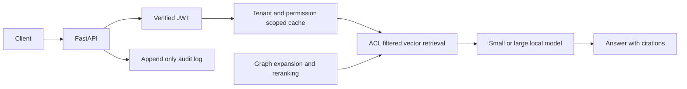

# Northwind RAG Platform



A RAG platform for studying permission enforcement, semantic caching and multi-hop
retrieval with reproducible evaluations. Development follows M0–M5 in TASK.md.
**Current status: M0 scaffold**; the diagram shows the intended completed system.
RAG endpoints, ingestion, evaluations and benchmarks arrive in later milestones.
The mock installation and checks pass on Windows with Python 3.11.9. Docker Compose
configuration validates; container startup and the real model adapters are unverified.
Ollama was unavailable in the development environment.

## Windows 11 quickstart (PowerShell)

```powershell
py -3.11 -m venv .venv311
.\.venv311\Scripts\Activate.ps1
$env:RAG_MODE="mock"
python tasks.py install
python tasks.py lint
python tasks.py test
python tasks.py run
```

If PowerShell blocks activation, use `.\.venv311\Scripts\python.exe` instead of
`python`. The `/health` endpoint is available at http://localhost:8000/health.
Use `Copy-Item .env.example .env` for configuration. Do not commit .env.
Mock mode runs without Docker, a model download, an API key or network access
after dependencies have been installed. Dependency installation needs package access.

On POSIX: `python3.11 -m venv .venv`, activate `.venv/bin/activate`, then run
`RAG_MODE=mock python tasks.py test`. A Makefile is available when make is installed.

All targets work through `python tasks.py TARGET` or `make TARGET`:
`install`, `test`, `lint`, `up`, `down`, `ingest`, `run`, `eval`, `bench-cache`,
`bench-acl`, `bench-graph`, `dashboard`, `report`. Later feature targets are wired
now; their modules will be implemented in the milestones listed in PROGRESS.md.
Extra arguments are forwarded, for example `python tasks.py test -q`.

## Containers

`docker compose up --build` starts Qdrant, Postgres 16, Neo4j 5 and the API.
The API defaults to mock mode. Set `RAG_MODE=real` in .env to opt into real adapters.
Database credentials in compose are public development defaults; replace them
before deploying. Container Ollama calls use `host.docker.internal:11434`.

## Producing real results

These commands apply once M1–M5 are implemented; no real benchmark has run yet.
Real model adapters require sentence-transformers and LiteLLM (optional dependency
setup and verified pins will be completed before the real-mode evaluation milestone).

```powershell
ollama pull llama3.2:3b
ollama pull qwen2.5:7b
Copy-Item .env.example .env
$env:RAG_MODE="real"
$env:SMALL_MODEL="ollama/llama3.2:3b"
$env:LARGE_MODEL="ollama/qwen2.5:7b"
docker compose up -d qdrant postgres neo4j
python tasks.py ingest
python tasks.py eval
python tasks.py bench-acl
python tasks.py test tests/test_leakage.py
python tasks.py bench-cache
python tasks.py bench-graph
python tasks.py report
```

Review the evaluation dataset, human judge verdicts, merge groups and failure
analysis before publishing results. Cost estimates will use explicitly labeled
reference prices, since local models do not incur paid API charges.

<!-- RESULTS:START -->
| Project | Real measurements |
| --- | --- |
| Permission-aware retrieval | NOT YET RUN |
| Semantic caching and routing | NOT YET RUN |
| GraphRAG | NOT YET RUN |
<!-- RESULTS:END -->

Dashboard screenshot: pending implementation and a real run.

## Limitations

Mock embeddings and answers test software contracts, not retrieval quality.
The finished evaluation must account for a small corpus, LLM judge bias, estimated
reference costs, semantic cache false hits, extraction and resolution errors,
GraphRAG indexing cost, and demo-grade authentication. See DECISIONS.md for trade-offs.
