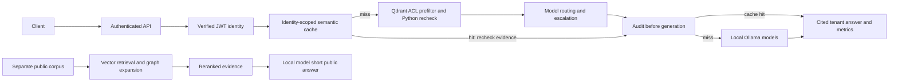

# Northwind RAG Platform

A local-model RAG lab for semantic caching, permission-aware retrieval and public graph-assisted question answering.
It combines verified identities, evidence filtering, immutable retrieval audits and measured routing trade-offs.
Deterministic offline checks exercise the contracts while archived real runs show the results and their limits.



## Results

<!-- RESULTS:START -->
<!-- REPORT:ARCHIVED -->
These tables use the named archived files, not a newer mock run. Rounded values are calculated from those files; reference costs are estimates, not local-model charges.

### Baseline

| Measurement | Result | File |
| --- | --- | --- |
| Manual answer review | 41 of 45 correct | [hand_labels.csv](results_archive/hand_labels.csv) |
| Agreement with human labels | reference_in_answer 87%; local 3B LLM judge 73% | [hand_labels.csv](results_archive/hand_labels.csv) |

Baseline/cache answer quality uses reference_in_answer; manual review remains the quality check, and the LLM judge is secondary.

### Project 1: semantic caching and routing

| Measurement | Result | File |
| --- | --- | --- |
| Comparison run context | CACHE_THRESHOLD=0.90; guard on | [summary_project1_real_threshold090.json](results_archive/summary_project1_real_threshold090.json) |
| Guarded full-sweep near misses at 0.90 | 2 false hits in 50 pairs | [cache_sweep_20261017T073343622572Z.csv](results_archive/cache_sweep_20261017T073343622572Z.csv) |
| Cache-hit reference correctness | 10 of 10 returned the correct reference | [project1_optimized_20261017T102733493678Z.csv](results_archive/project1_optimized_20261017T102733493678Z.csv) |
| Estimated reference-cost reduction | 58.0% | [summary_project1_real_threshold090.json](results_archive/summary_project1_real_threshold090.json) |
| Latency increase | p50 +4.2 s; p95 +22.5 s | [summary_project1_real_threshold090.json](results_archive/summary_project1_real_threshold090.json) |
| Simple-routed requests escalated | 43% | [summary_project1_real_threshold090.json](results_archive/summary_project1_real_threshold090.json) |

Escalation adds a sequential model call and explains the latency trade-off; the paired run does not isolate causality. Models ran locally; costs are reference-price estimates ([summary_project1_real_threshold090.json](results_archive/summary_project1_real_threshold090.json), [project1_optimized_20261017T102733493678Z.csv](results_archive/project1_optimized_20261017T102733493678Z.csv)).

### Project 2: permission-aware retrieval

| Measurement | Result | File |
| --- | --- | --- |
| Live-server leakage suite | 602 passed | [leakage_live_qdrant.txt](results_archive/leakage_live_qdrant.txt) |
| Backend scope | Live Qdrant; deterministic mock embeddings; SQLite audit log | [leakage_live_qdrant.txt](results_archive/leakage_live_qdrant.txt) |

### Project 3: public GraphRAG

| Measurement | Result | File |
| --- | --- | --- |
| vector | EM 30.0%; F1 42.1%; supporting-title recall 85.0% | [project3_20261019T174828737665Z.csv](results_archive/project3_20261019T174828737665Z.csv) |
| graph_hybrid | EM 45.0%; F1 56.0%; supporting-title recall 90.8% | [project3_20261019T174828737665Z.csv](results_archive/project3_20261019T174828737665Z.csv) |
| First-fill indexing coverage | 400 of 600 paragraphs measured; total cost unknown | [summary_project3_real_final.json](results_archive/summary_project3_real_final.json) |
| Decomposition | NOT YET RUN with ollama/llama3.2:3b: excluded after invalid sub-question lists | [summary_project3_real_final.json](results_archive/summary_project3_real_final.json) |

HotpotQA is multi-hop: no single-hop questions are present in this run, so no single-hop result exists ([project3_20261019T174828737665Z.csv](results_archive/project3_20261019T174828737665Z.csv), [summary_project3_real_final.json](results_archive/summary_project3_real_final.json)). Indexing cost is partly measured; recorded elapsed time includes stalls and timeouts from earlier runs, and the extraction cache mixes code versions ([summary_project3_real_final.json](results_archive/summary_project3_real_final.json), [extraction_failures.log](results_archive/extraction_failures.log)).
<!-- RESULTS:END -->

## What was and was not verified

- Real baseline answers, local-model cache/routing comparisons and public vector/GraphRAG evaluation are archived in the files named above. These are bounded workloads, not production guarantees.
- The live-server leakage suite used live Qdrant with deterministic mock embeddings and a SQLite audit log. PostgreSQL audit triggers and the Dockerized API container were not verified; real model generation and cached live-vector isolation are outside this suite's scope. See [leakage_live_qdrant.txt](results_archive/leakage_live_qdrant.txt).
- Real extraction timeouts were recorded and later checkpointed graph evaluation completed. This supports observed failures and subsequent completed work, not a controlled live timeout/recovery experiment. See [extraction_failures.log](results_archive/extraction_failures.log) and [summary_project3_real_final.json](results_archive/summary_project3_real_final.json).
- Decomposition was excluded after invalid sub-question lists; the archived summary records the evaluated systems, not a decomposition score. See [summary_project3_real_final.json](results_archive/summary_project3_real_final.json).

## Limitations

- Cache safety on the tuning pairs is not production safety: the guarded sweep still recorded false hits at the comparison threshold. Correct references on the observed cache hits do not eliminate that risk. See [cache_sweep_20261017T073343622572Z.csv](results_archive/cache_sweep_20261017T073343622572Z.csv) and [project1_optimized_20261017T102733493678Z.csv](results_archive/project1_optimized_20261017T102733493678Z.csv).
- The threshold and enabled guard are supplied run context for the named comparison archive; that summary did not persist explicit threshold/guard configuration fields. Its numeric comparison measurements are recorded. See [summary_project1_real_threshold090.json](results_archive/summary_project1_real_threshold090.json).
- reference_in_answer is a lexical check: equivalent wording can fail and negated answers can still contain a reference. Human agreement is the calibration evidence, not proof of correctness. See [hand_labels.csv](results_archive/hand_labels.csv).
- Extraction and resolution can lose facts or conflate entities. The cache mixes code versions, first-fill history is incomplete, and recorded elapsed time includes earlier stalls/timeouts; do not interpret it as clean indexing speed or a complete indexing bill. See [summary_project3_real_final.json](results_archive/summary_project3_real_final.json), [merge_groups.txt](results_archive/merge_groups.txt) and [extraction_failures.log](results_archive/extraction_failures.log).
- Protected tenant retrieval and public GraphRAG are separate systems; the public graph has no tenant ACL enforcement. The live leakage evidence applies to the fixture and backend scope stated above, not container or PostgreSQL verification.

## Details

See [implementation notes and PowerShell quickstarts](docs/IMPLEMENTATION_NOTES.md), [study notes](docs/STUDY_NOTES.md) and [decisions](DECISIONS.md).

```powershell
$env:RAG_MODE="mock"
python tasks.py install
python tasks.py test -m "not integration"
python tasks.py run
python tasks.py report
```
